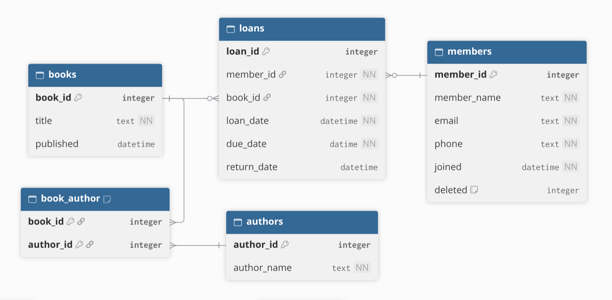

# Team Project - Python & AI

## Book Club Library API

## Project setup

### Requirements

- Python 3.10 or newer
- Git
- uv (recommended) or pip

### Installation with uv

Clone the repository:

    git clone https://github.com/giorgi-dundua/book-club-library.git
    cd book-club-library

Create the virtual environment and install dependencies:

    uv venv
    uv pip install -r requirements.txt

Activate the environment on Linux/macOS:

    source .venv/bin/activate

### Alternative: pip

If uv is not installed, use Python's built-in venv:

    python -m venv .venv
    source .venv/bin/activate
    python -m pip install -r requirements.txt

### Initialize the database

Create and populate the SQLite database with sample data:

    python seed.py

On first execution, the script creates `bookclub.db`, initializes the
database tables, and inserts sample books, authors, members, and loans.

If the database already contains tables, the script asks for confirmation
before resetting them. Type `RESET` to delete existing records and
recreate the database with sample data. Any other input cancels the reset.

**Warning:** Resetting the database permanently deletes existing records.
Do not run a reset when you need to preserve data.

Database initialization is a separate setup step and is not required
every time the API starts.

### Run the API

    fastapi dev main.py

The API runs locally at:

- http://127.0.0.1:8000
- http://127.0.0.1:8000/docs
- http://127.0.0.1:8000/health

### Run the client

The client uses Streamlit and needs the API to be running.
Set `API_KEY` in `.env` before starting the API and client. This key is
needed to add, edit and delete books.

Open two terminals in the project folder. Activate the virtual environment
in both:

    source .venv/bin/activate

Start the API in the first terminal:

    fastapi dev main.py

Start the client in the second terminal:

    streamlit run client.py

Open the address shown by Streamlit in your browser. The client connects
to the API at `http://127.0.0.1:8000`.

### Run tests

    python -m pytest -q

### Environment variables

Copy `.env.example` to `.env` when configuration is required.
Set a private API key in `.env`. Never commit real credentials.

## API endpoints

Endpoints marked Yes require an `X-API-Key` header matching `API_KEY` in
`.env`. A missing or incorrect key returns HTTP 401. Open `/docs` for
request bodies, response examples and a way to try the endpoints.

| Method | Path | Description | API key |
|---|---|---|---|
| GET | `/health` | Check that the API is running | No |
| GET | `/books/{book_id}` | Get one book and its authors | No |
| GET | `/books/never-borrowed` | List books with no loan history | No |
| POST | `/books` | Add one book or a list of books | Yes |
| PUT | `/books/{book_id}` | Replace a book's details | Yes |
| PATCH | `/books/{book_id}` | Update selected book details | Yes |
| DELETE | `/books/{book_id}` | Delete a book with no loan history | Yes |
| POST | `/members` | Register a member | Yes |
| PATCH | `/members/{member_id}` | Update a member's contact details | Yes |
| GET | `/members/personal` | Get members' personal data and loan history | Yes |
| GET | `/members/{member_id}/personal` | Get one member's personal data and loan history | Yes |
| DELETE | `/members/{member_id}` | Delete a member or replace their personal details | Yes |
| GET | `/loans` | List active loans | Yes |
| POST | `/loans` | Record a book loan | Yes |
| PATCH | `/loans/{loan_id}/return` | Record a book return | Yes |
| GET | `/members/{member_id}/loans` | List a member's active loans | Yes |
| GET | `/statistics/most-borrowed` | Rank books by total number of loans | No |

Successful book and member deletion returns HTTP 204 with no response
body. Book deletion returns HTTP 409 if the book has any loan records,
including returned loans, so borrowing history is preserved.

## Personal data

The `members` table stores each member's name, email address, phone number
and joining date. The name identifies the member, the email and phone
provide contact details, and the joining date records when they registered.
The table also stores a member ID and a `deleted` flag.

The `loans` table links a member ID to a book ID and records the loan,
due and return dates. These records are needed to track borrowed books,
returns, overdue loans and borrowing history. Member data and loan reports
require the API key.

We do not store national identification numbers, home addresses,
passwords or payment details.

When a member has loan history, deleting the member replaces their name,
email, phone and joining date with fixed values and sets `deleted` to 1.
Their member ID and loan records remain so the borrowing history is kept.
The personal-data endpoints exclude these deleted members. A member with
no loan history is removed from the database entirely.

## ER Diagram

