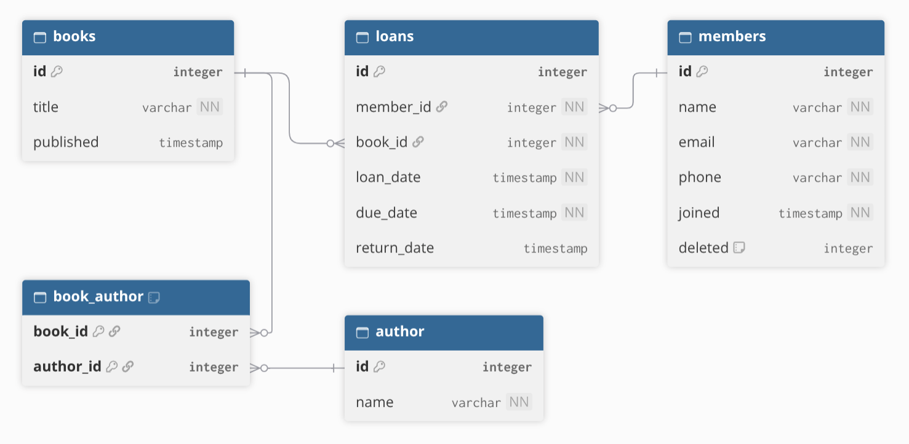

# Team Project - Python & AI

## Book Club Library API

## Project setup

### Requirements

- Python 3.10 or newer
- Git
- uv (recommended) or pip

### Installation with uv

Clone the repository:

    git clone https://github.com/giorgi-dundua/book-club-library.git
    cd book-club-library

Create the virtual environment and install dependencies:

    uv venv
    uv pip install -r requirements.txt

Activate the environment on Linux/macOS:

    source .venv/bin/activate

### Alternative: pip

If uv is not installed, use Python's built-in venv:

    python -m venv .venv
    source .venv/bin/activate
    python -m pip install -r requirements.txt

### Run the API

    fastapi dev main.py

The API runs locally at:

- http://127.0.0.1:8000
- http://127.0.0.1:8000/docs
- http://127.0.0.1:8000/health

### Run tests

    python -m pytest -q

### Environment variables

Copy `.env.example` to `.env` when configuration is required.
Set a private API key in `.env`. Never commit real credentials.

### Development status

The FastAPI application is initialized. Database integration, CRUD
endpoints, API-key authentication, and the Python client are under development.

## ER Diagram

